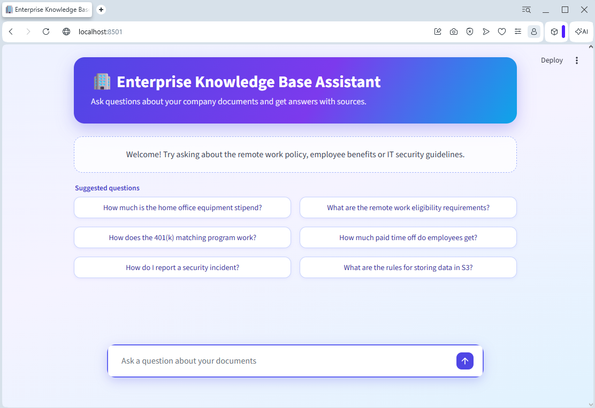
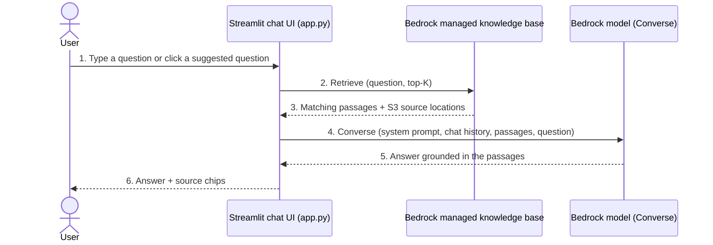

# Enterprise Knowledge Base Assistant


An enterprise knowledge base chat assistant built on an Amazon Bedrock managed knowledge base, designed for **faster onboarding** and everyday self-service questions.

---



---
## Introduction

New hires, and anyone else who needs answers from company documents, lose time searching shared drives, wikis and PDFs, or waiting for someone to reply. The Enterprise Knowledge Base Assistant lets them ask questions in plain language and get an answer grounded in your own documents, with the source files listed next to it.

A short CloudFormation template creates the AWS resources. A single-page Streamlit app, run on your machine, provides the chat interface. The app includes a **Suggested questions** panel above the chat bar, so people can start with common questions in one click.

## Use cases

The assistant answers only from the documents you load, so the same project serves many teams. Put different documents in the knowledge base to cover different use cases:

| Use case | Example documents | Example questions |
|---|---|---|
| **New hire onboarding** | Onboarding guides, org charts, first-week checklists | What do I need to do in my first week? Who do I contact for laptop issues? |
| **HR policies and benefits** | Benefits handbook, leave and PTO policy | How does the 401(k) match work? How much paid time off do I get? |
| **Remote and hybrid work** | Remote work policy, equipment and travel rules | How much is the home office stipend? Am I eligible for remote work? |
| **IT and security** | Security standards, acceptable use policy, incident process | How do I report a security incident? What are the password and MFA rules? |
| **Internal support and helpdesk** | FAQs, runbooks, how-to guides | How do I request VPN access? |
| **Compliance and training** | Compliance policies, training material | Which data classification applies to customer data? |

The included `sample_data/` folder covers the HR, remote work and IT security cases. To add another use case, upload more documents to the S3 bucket and run the ingestion job again. No code change is needed.

## Overview of the solution


How a question flows through the system (app.py):
1. Ask: the user types a question or clicks a suggested question in the Streamlit chat UI.
2. Retrieve: the app calls the Bedrock Retrieve API with the question and TOP_K_RESULTS.
3. Passages returned: the managed knowledge base returns the best-matching passages and the S3 location of each source document.
4. Generate: the app calls the Bedrock Converse API with a system prompt (answer only from the context), the earlier chat turns, the passages and the question.
5. Answer: the model writes an answer grounded in those passages. If the passages do not contain the answer, it says it does not know.
6. Respond: the UI shows the answer with the source documents as chips, and keeps the turn as context for follow-up questions.


The CloudFormation stack ([`cloudformation/managed-kb-stack.yaml`](cloudformation/managed-kb-stack.yaml)) creates:

| Resource | Purpose |
|---|---|
| S3 bucket | Holds your source documents |
| IAM role | Lets Bedrock read that bucket (and nothing else) |
| Knowledge base, type `MANAGED` | Bedrock stores and indexes the vectors for you. No OpenSearch, no vector index, no embedding model to pick |
| Data source (S3 connector) | Connects the bucket to the knowledge base |

The stack's **Outputs** give you the ready-made `.env` content and the two commands needed to load your documents.

The app ([`app.py`](app.py)) calls the `Retrieve` API with `managedSearchConfiguration`, then passes the retrieved passages to the Bedrock `Converse` API to generate the answer. Managed knowledge bases do not support `RetrieveAndGenerate` and reject `vectorSearchConfiguration`, which is only for custom (self-managed vector store) knowledge bases.

## Prerequisites

- An AWS account and credentials that can create S3, IAM and Bedrock resources.
- [AWS CLI v2](https://docs.aws.amazon.com/cli/latest/userguide/install-cliv2.html), configured (`aws configure`) and working: `aws sts get-caller-identity`.
- Python 3.10 or later.
- A region where Bedrock managed knowledge bases are available (the examples use `us-east-1`).
- Access to a text-generation model in that region. The stack defaults to the `us.amazon.nova-pro-v1:0` inference profile. If you use another model, pass it as the `GenerationModelId` parameter.

## Step-by-step deployment process

### 1. Deploy the CloudFormation stack

```bash
aws cloudformation create-stack \
  --stack-name managed-kb-chat \
  --template-body file://cloudformation/managed-kb-stack.yaml \
  --capabilities CAPABILITY_IAM \
  --region us-east-1

aws cloudformation wait stack-create-complete --stack-name managed-kb-chat --region us-east-1
```

To use another generation model, add `--parameters ParameterKey=GenerationModelId,ParameterValue=<model-or-profile-id>`.

Then read the outputs:

```bash
aws cloudformation describe-stacks --stack-name managed-kb-chat --region us-east-1 \
  --query "Stacks[0].Outputs[].[OutputKey,OutputValue]" --output text
```

(You can also open the stack in the CloudFormation console and use the **Outputs** tab.)

### 2. Load the documents and index them

Run the two commands from the `UploadDocuments` and `StartIngestion` outputs. They look like this:

```bash
aws s3 sync ./sample_data s3://<bucket-name>/ --region us-east-1
aws bedrock-agent start-ingestion-job --knowledge-base-id <kb-id> --data-source-id <data-source-id> --region us-east-1
```

Indexing takes a few minutes. Check its status with:

```bash
aws bedrock-agent list-ingestion-jobs --knowledge-base-id <kb-id> --data-source-id <data-source-id> --region us-east-1 \
  --query "ingestionJobSummaries[0].status"
```

Wait for `COMPLETE`. Run the ingestion command again whenever you add or change documents.

### 3. Set up the local environment

```bash
python -m venv .venv
# macOS/Linux: source .venv/bin/activate
# Windows PowerShell: .\.venv\Scripts\Activate.ps1
pip install -r requirements.txt
```

Create a file named `.env` in the project folder and paste the value of the **`EnvFile`** stack output into it. It looks like this:

```ini
AWS_REGION=us-east-1
BEDROCK_KNOWLEDGE_BASE_ID=ABCDEFGHIJ
DEFAULT_MODEL_ARN=arn:aws:bedrock:us-east-1:111122223333:inference-profile/us.amazon.nova-pro-v1:0
TOP_K_RESULTS=5
```

If you use a named AWS profile, add `AWS_PROFILE=<name>`. The IAM identity running the app needs `bedrock:Retrieve` and `bedrock:InvokeModel`.

### 4. Run the app

```bash
streamlit run app.py
```

## Result: test the app

Open <http://localhost:8501> and ask questions about the sample documents. You can click one of the **Suggested questions** above the chat bar, or type your own, for example:

- What equipment allowance do remote employees get?
- What does the company match on 401(k) contributions?
- How often do passwords have to be changed, and is MFA required?

Each answer is followed by a **Sources** line listing the S3 files it was based on. Follow-up questions keep their context for the length of the browser session.

To change the suggested questions, edit the `SUGGESTED_QUESTIONS` list in [`app.py`](app.py) so they match your own documents and use cases.

If something goes wrong:

| Symptom | Likely cause |
|---|---|
| Answers say nothing was found | The ingestion job is not `COMPLETE` yet, or no documents were uploaded |
| `vectorSearchConfiguration is not supported for managed knowledge bases` | You are running an older copy of the app, or the boto3 version is too old. Run `pip install -U -r requirements.txt` |
| `AccessDeniedException` on the model | Enable access to the model in the Bedrock console, or pass a different `GenerationModelId` |
| `ValidationException` about the model ARN | The model needs an inference profile in your region. Use the profile ID (for example `us.`, `eu.`) that matches your region |

To remove everything:

```bash
aws s3 rm s3://<bucket-name> --recursive
aws cloudformation delete-stack --stack-name managed-kb-chat --region us-east-1
```

## Conclusion

With one template and one Python file you have a working Enterprise Knowledge Base Assistant that helps new hires get productive faster and gives every team a single place to find answers. Bedrock handles chunking, embeddings, the vector store and retrieval. The app only sends a question and shows the answer with its sources. From here you can add documents for more use cases (upload and re-run ingestion), update the suggested questions, tune `TOP_K_RESULTS`, or swap in a different generation model by changing `DEFAULT_MODEL_ARN`.
